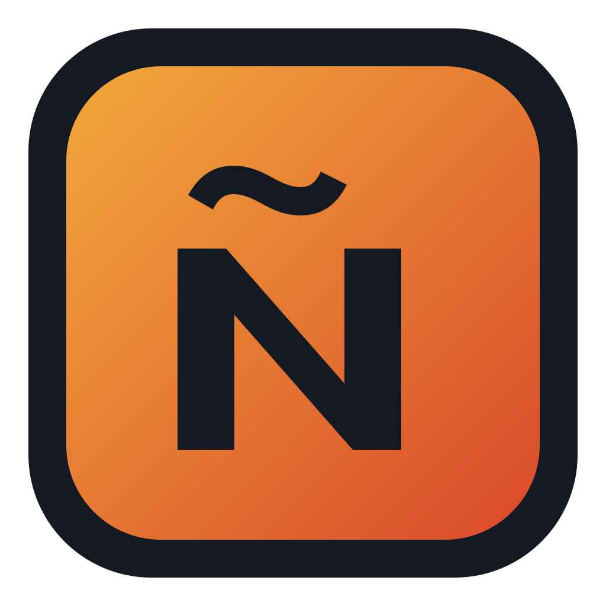
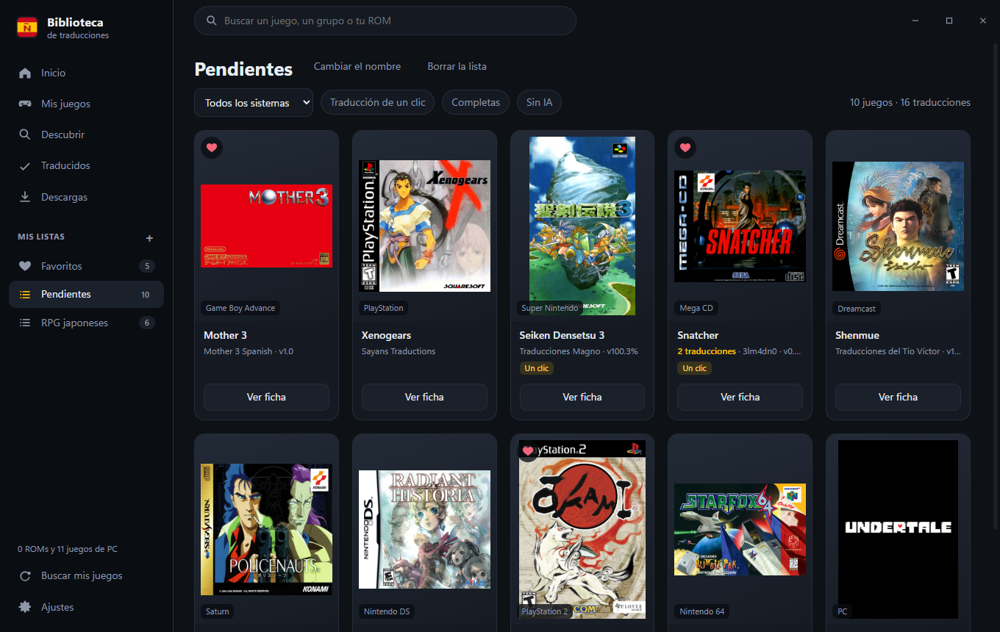
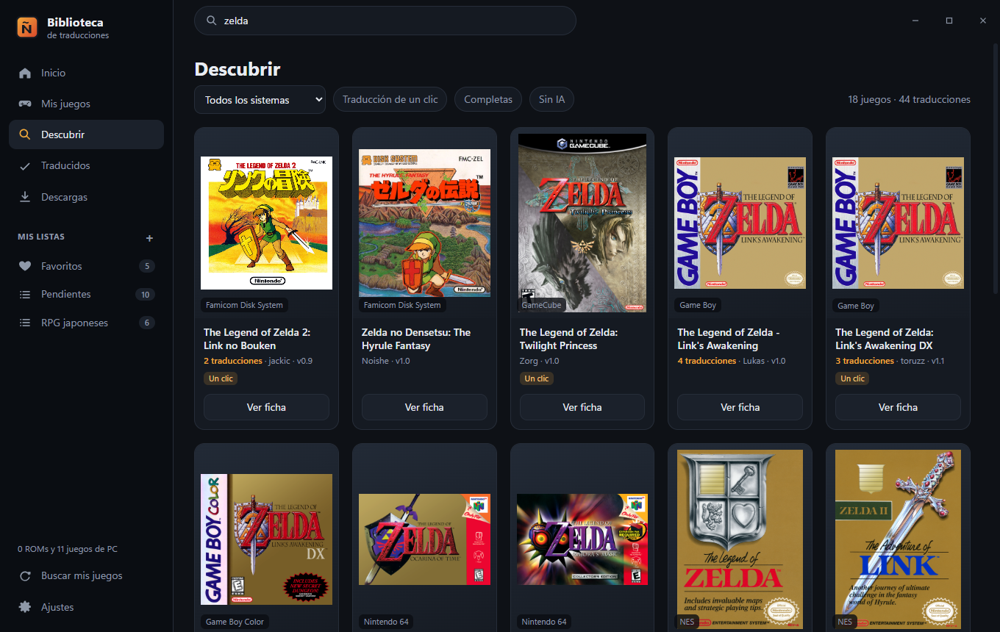
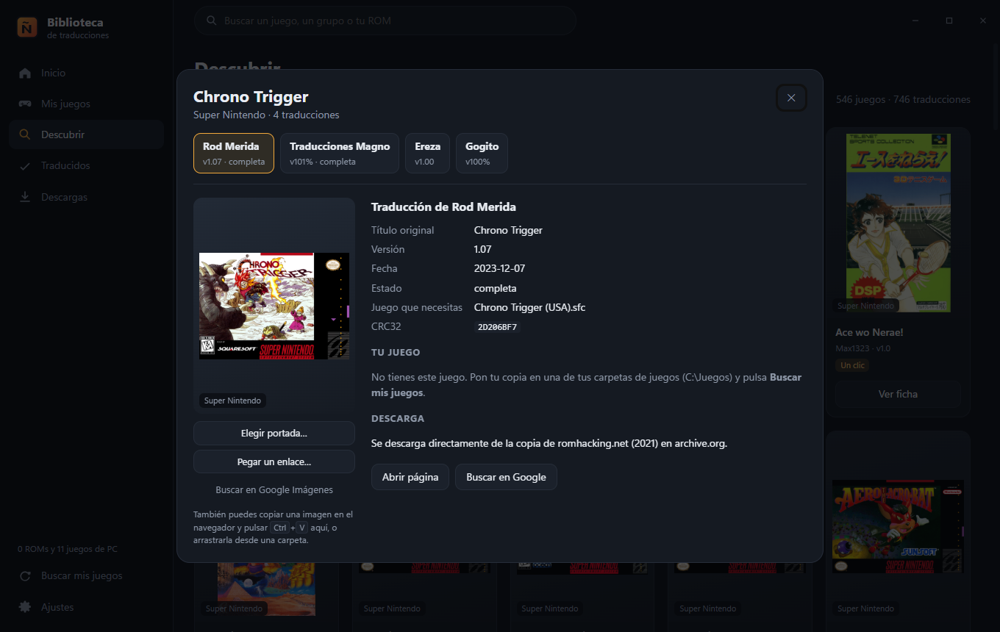

<h1 align="center">Biblioteca de traducciones</h1>

<b>Juega en español a juegos que nunca salieron traducidos.</b> 
Más de 6.000 traducciones hechas por aficionados, de la NES a la Switch y los juegos de PC de hoy.

  
  
  
  
  

<a href="https://github.com/alucardog-dotcom/biblioteca-traducciones/releases/latest"><b>⬇️ Descargar para Windows</b></a> · <a href="https://bibliotecadetraducciones.com/"><b>🔎 Buscar tu juego en la web</b></a>

¿Tienes un juego japonés de Super Nintendo, un RPG de PlayStation que nunca llegó a España o un juego de Steam que solo está en inglés? Hay muchas probabilidades de que alguien lo haya traducido. La Biblioteca de traducciones busca tus juegos, te dice cuáles tienen traducción al español y la aplica con un clic. **Nunca descarga juegos**: solo los parches de traducción, que se aplican sobre tu propia copia, y tu copia queda intacta.

## Qué hace

- **Catálogo** de 6.163 traducciones al español de 5.357 juegos: consolas y ordenadores clásicos (NES, Super Nintendo, Mega Drive, Game Boy, PlayStation, PS2, Nintendo DS…), MS-DOS, PC y consolas actuales (Switch, PS3, PS4 y Xbox 360). Cada juego tiene una sola ficha, y dentro eliges entre sus traducciones.
- **Busca tus juegos** en las carpetas que elijas: ROMs sueltas o en .zip, .7z y .rar; discos .cue/.bin, .gdi y .chd; juegos de Switch, Wii U, PS3, PS4 y Xbox 360 (.nsp, .xci, .wua, .pkg, .xex…). También encuentra los juegos de PC que tienes instalados con Steam, GOG y Epic.
- **Comprueba que tu copia es la buena**: por su CRC32 sabe si es la versión que pide la traducción, también sin la cabecera de NES o de SNES.
- **Descarga el parche y lo aplica**: IPS, BPS, UPS, PPF, APS y xdelta. Saca el juego de su comprimido o de su .chd y devuelve los discos traducidos en .chd. El traducido queda junto al original con la etiqueta `[T-Es]`, o en la carpeta que elijas.
- **Sin descarga directa**: abre la página de la traducción y, en cuanto bajas el parche, lo aplica él solo.
- **Juegos de PC y de consolas actuales**: sus traducciones se instalan a mano (en la carpeta del juego, o como mod en el emulador o en la consola). La biblioteca te dice cuáles tienes y te lleva a la página de la traducción y a la carpeta del juego.
- **¿No tienes el juego?** En los que se venden en Steam, la ficha enlaza a su búsqueda en Instant Gaming (enlace de afiliado: si lo compras, el proyecto se lleva una pequeña comisión sin que te cueste más). En los que no están en Steam, si se conoce su página oficial (itch.io, Game Jolt o la web de su autor), enlaza a ella, sin afiliado.
- **Portadas** de libretro-thumbnails, Steam y LaunchBox. Si falta alguna, puedes poner la tuya: elegir una imagen, pegarla con Ctrl+V o soltarla sobre el juego.
- **Favoritos y listas**: pulsa el corazón de un juego para tenerlo en Favoritos, o guárdalo en tus propias listas («Pendientes», «RPG japoneses»…) para volver a él más tarde.
- **Con RetroBat**, el botón Jugar abre el juego traducido con su emulador.
- **Descubrir** te propone cada día una tanda de juegos al azar con traducción completa, uno por sistema, para empezar por algún sitio.
- **Juegos para adultos**: sus traducciones van ocultas de serie. Si eres mayor de edad, actívalas en Ajustes.

## Instalar

Descarga el instalador (`Biblioteca-de-traducciones-setup.exe`) de la [última versión](../../releases/latest) y ábrelo. Funciona en Windows 10 y 11 de 64 bits.

El instalador no está firmado (el porqué, en [Code signing policy](#code-signing-policy)), así que Windows puede avisar con «Windows protegió su PC». Para instalarlo, pulsa **Más información** y luego **Ejecutar de todas formas**.

Al abrirlo por primera vez te pregunta en qué carpetas tienes tus juegos. El catálogo se pone al día solo cada vez que lo abres, y cada seis horas mientras siga abierto, sin reinstalar nada. Cuando sale una versión nueva del programa, aparece un aviso abajo a la izquierda. Si no quieres esperar, en Ajustes › Acerca de el botón **Buscar actualizaciones** comprueba las dos cosas al momento.

## De dónde salen las traducciones

Las traducciones son de sus autores. Este programa solo las encuentra y las aplica, y las descarga de su sitio original cuando ese sitio lo permite: [Traducciones Wave](https://traduccioneswave.top), la copia de romhacking.net de 2021 en [archive.org](https://archive.org/details/rhdn-20210914), GitHub y la [copia de parches de RetroAchievements](https://github.com/RetroAchievements/RAPatches). Para el resto, la ficha lleva a la página de la traducción.

El catálogo se ha hecho con los listados de romhacking.net, Traducciones Wave, Romhack Plaza, TraduSquare, Romhack Hispano, El Otro Lado, Steam Community, RetroAchievements, Abandonsocios, Parches en Castellano y blogs y repositorios de traductores. Si eres autor de una traducción y quieres corregir su ficha o que no aparezca, [abre una incidencia](../../issues).

No se enlazan las webs que reparten juegos ya parcheados o completos; de Abandonsocios se enlaza el hilo del foro donde está cada traducción. Las traducciones hechas con IA o con traducción automática van marcadas, y hay un filtro para ocultarlas; otro filtro, «En Steam», deja solo los juegos que se venden en Steam.

## Privacidad

El programa no envía datos tuyos a ningún sitio. Solo se conecta para:

- **Portadas:** thumbnails.libretro.com, la CDN de Steam e images.launchbox-app.com.
- **Parches:** traduccioneswave.top, archive.org y github.com.
- **Versión y catálogo nuevos:** api.github.com y raw.githubusercontent.com, para ver si hay una versión nueva del programa y para traer el catálogo más reciente.

Tus ajustes, tus listas y tus datos se guardan en tu equipo: `%APPDATA%\es.traducciones.biblioteca` y `%LOCALAPPDATA%\es.traducciones.biblioteca`.

## Code signing policy

El instalador no está firmado todavía. En noviembre de 2026 se pidió la firma gratuita de [SignPath Foundation](https://signpath.org), que la da a programas de código libre con cierta difusión, y la dejaron para más adelante porque el proyecto era demasiado nuevo; se volverá a pedir cuando tenga más usuarios. Mientras tanto, cada instalador lo compila GitHub Actions desde este repositorio ([publicar.yml](.github/workflows/publicar.yml)) y en la página de cada versión GitHub muestra su huella SHA-256, con la que puedes comprobar que el fichero que has bajado es el que se publicó.

## ¿Te gusta?

La Biblioteca de traducciones es gratuita y la hago en mi tiempo libre. Si te resulta útil y quieres echar una mano, puedes **[invitarme a un café por PayPal](https://paypal.me/btraducciones)**. ¡Gracias! ☕

Las donaciones son para el desarrollo de este programa. Las traducciones son de sus autores: si quieres apoyarlos a ellos, mira en la página de cada traducción si aceptan donaciones.

También ayuda mucho avisar de traducciones que falten o que no funcionen ([incidencias](https://github.com/alucardog-dotcom/biblioteca-traducciones/issues)) y compartir el programa.

## Compilar

Cómo está hecho y cómo compilarlo: [DESARROLLO.md](DESARROLLO.md). Está hecho con [Tauri 2](https://tauri.app) (Rust y una ventana en HTML, CSS y JavaScript) y se inspira en [RecompLauncher](https://github.com/elripalda/RecompLauncher), de Ripalda, aunque no usa su código.

## Licencia

El código de este programa es software libre: puedes usarlo, estudiarlo, cambiarlo y repartirlo según la [licencia GNU GPL versión 3](LICENSE) o, si lo prefieres, cualquier versión posterior.

Lleva dentro 7-Zip, xdelta3 y chdman (de MAME), cada uno con su licencia: ver [LICENCIAS.txt](src-tauri/recursos/herramientas/LICENCIAS.txt). Las portadas son de sus propietarios. Este programa no está relacionado con ninguna de las empresas de los juegos.
